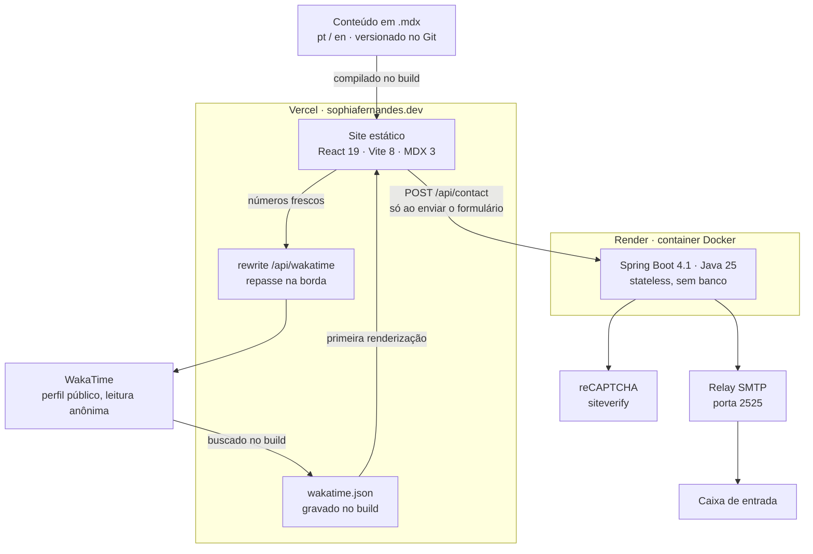
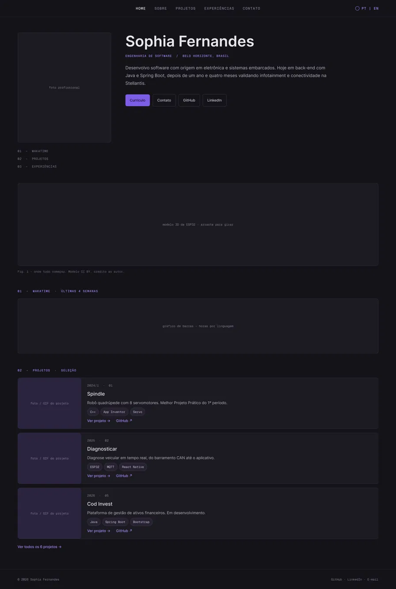
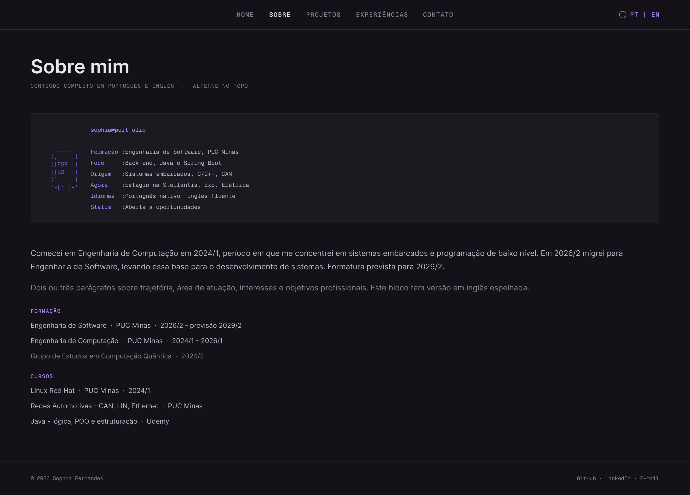
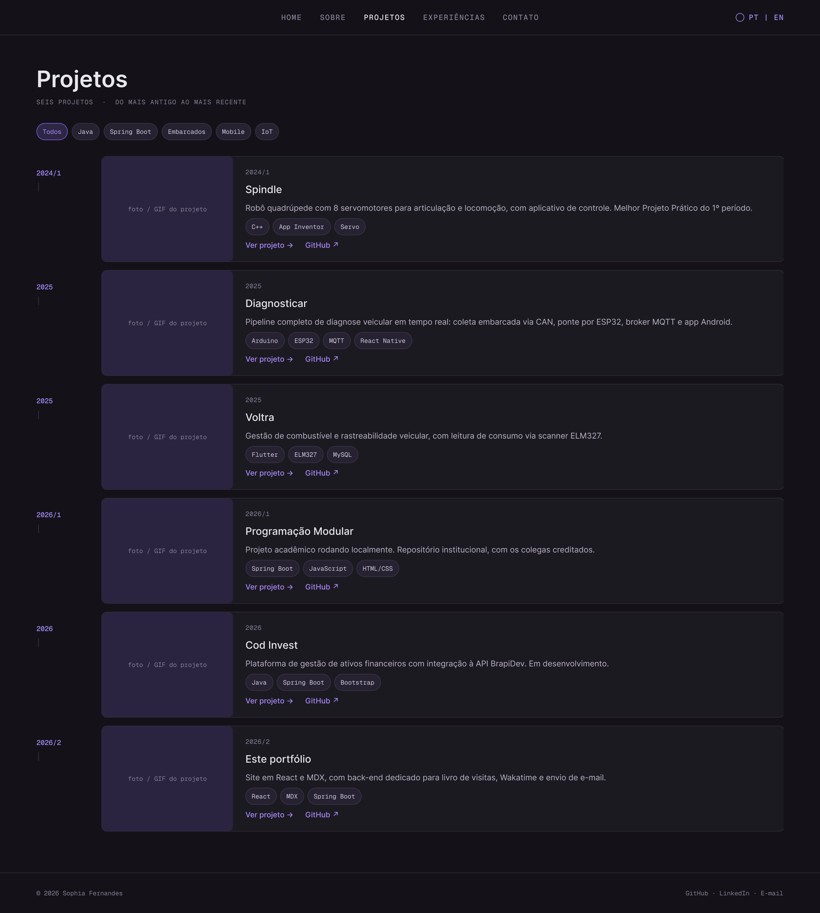
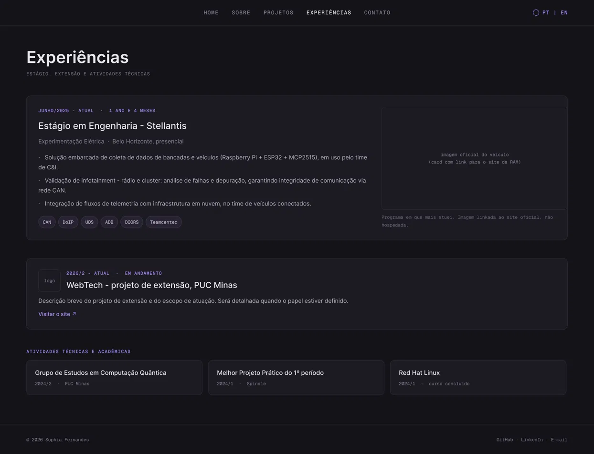
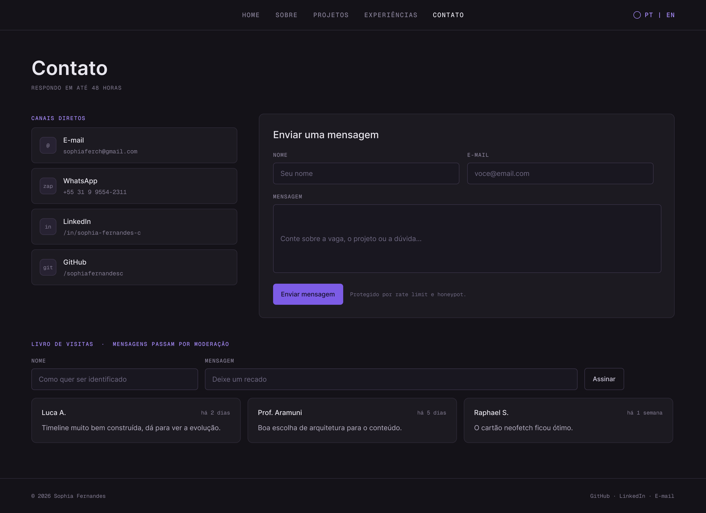

# 🏷️ Portfólio Profissional - Sophia Fernandes 👨‍💻

> [!NOTE]
> Site de portfólio profissional que reúne trajetória, projetos, experiências e formas de contato, em português e inglês.
> Conteúdo versionado em arquivos MDX: cada projeto é um arquivo, o que mantém a documentação do projeto junto do código.

<table>
  <tr>
    <td width="800px">
      <div align="justify">
        Este projeto é o <b>Laboratório 01</b> da disciplina <b>DIAW - Desenvolvimento e Integração de Aplicações Web</b>, do curso de Engenharia de Software da PUC Minas. O objetivo é projetar e desenvolver um website de portfólio profissional, cobrindo <i>front-end</i>, <i>back-end</i> e <i>hospedagem na nuvem</i>. O site apresenta uma seção <b>Sobre Mim</b> bilíngue, uma <b>linha do tempo de projetos</b> do mais antigo ao mais recente, as <b>experiências profissionais e acadêmicas</b> e uma página de <b>contato</b> com formulário funcional. Além dos requisitos obrigatórios, o projeto exibe um <b>gráfico de horas por linguagem</b> a partir das estatísticas públicas do Wakatime.
      </div>
    </td>
    <td>
    </td>
  </tr>
</table>

---

## 🚧 Status do Projeto

> [!NOTE]
> **No ar em [sophiafernandes.dev](https://sophiafernandes.dev) - Sprint 03 (hospedagem e finalização).**
> Sprint 01: planejamento, wireframes e Design System. Sprint 02: front-end, conteúdo bilíngue e formulário de contato enviando e-mail de verdade, com reCAPTCHA conferido no servidor. Sprint 03: front-end na Vercel, back-end em container no Render e domínio próprio.

[](https://github.com/sophiafernandesc/sophiafernandes-portfolio/releases)


---

## 📚 Índice
- [Links Úteis](#-links-úteis)
- [Sobre o Projeto](#-sobre-o-projeto)
- [Funcionalidades Principais](#-funcionalidades-principais)
- [Tecnologias Utilizadas](#-tecnologias-utilizadas)
- [Arquitetura](#-arquitetura)
  - [Visão geral da stack](#visão-geral-da-stack)
  - [Como o MDX funciona neste projeto](#como-o-mdx-funciona-neste-projeto)
  - [Decisões e trade-offs](#decisões-e-trade-offs)
- [Instalação e Execução](#-instalação-e-execução)
  - [Pré-requisitos](#pré-requisitos)
  - [Variáveis de Ambiente](#-variáveis-de-ambiente)
  - [Instalação de Dependências](#-instalação-de-dependências)
  - [Como Executar a Aplicação](#-como-executar-a-aplicação)
- [Deploy](#-deploy)
- [Estrutura de Pastas](#-estrutura-de-pastas)
- [Demonstração](#-demonstração)
- [Testes](#-testes)
- [Documentações utilizadas](#-documentações-utilizadas)
- [Autores](#-autores)
- [Contribuição](#-contribuição)
- [Agradecimentos](#-agradecimentos)
- [Licença](#-licença)

---

## 🔗 Links Úteis

* 🌐 **Site publicado:** **[sophiafernandes.dev](https://sophiafernandes.dev)**
  > 💻 Front-end estático na Vercel; API de contato em container no Render.
* 🎨 **Protótipos (Figma):** [Wireframes e Design System](https://www.figma.com/design/rZBIBF1oWuGe6IK20gs4RA/Portfolio)
  > 📐 Wireframes de média fidelidade das cinco páginas, versão mobile da home e o Design System com cores e tipografia.
* 📄 **Currículo:** [em português](https://sophiafernandes.dev/curriculo-sophia-fernandes.pdf) · [in English](https://sophiafernandes.dev/resume-sophia-fernandes-en.pdf)

---

## 📝 Sobre o Projeto

O portfólio nasceu de uma necessidade concreta: reunir num só lugar uma trajetória que começou em eletrônica e sistemas embarcados e hoje se concentra em desenvolvimento de software. Currículo em PDF e perfil do LinkedIn não dão conta de mostrar um pipeline que vai do barramento CAN até a tela de um aplicativo - precisa de imagem, de GIF e de espaço para explicar decisão de arquitetura.

**Qual problema resolve.** Um recrutador tem poucos minutos e precisa entender, rápido, o que a pessoa já construiu e com o quê. O site organiza isso em uma linha do tempo cronológica, em que cada projeto traz descrição, tecnologias, evidência visual e link para o repositório - e, quando o projeto merece, uma página própria com arquitetura e capturas de tela.

**Contexto.** Acadêmico e profissional ao mesmo tempo: é o Laboratório 01 da disciplina DIAW, avaliado em 15 pontos distribuídos em três sprints, e também uma peça real de apresentação profissional, que continua no ar depois da entrega.

**O que o torna diferente.** A progressão da linha do tempo é o próprio argumento: de um robô quadrúpede em C++ em 2024 a uma plataforma full-stack em Java e Spring Boot em 2026. A origem em embarcados não é um detalhe do passado, é o diferencial que explica a forma de resolver problema.

---

## ✨ Funcionalidades Principais

**Obrigatórias (enunciado):**

- 🌐 **Sobre Mim bilíngue:** apresentação completa em português e inglês, com alternância de idioma em todo o site.
- 🗓️ **Linha do tempo de projetos:** ordenada do mais antigo ao mais recente, com nome, descrição, tecnologias, link do repositório e imagem ou GIF de cada projeto.
- 💼 **Experiências:** estágio, projeto de extensão e atividades técnicas, com instituição, cargo, período e descrição.
- 📨 **Contato:** ícones clicáveis para e-mail, WhatsApp, LinkedIn e GitHub, mais formulário com nome, e-mail e mensagem, com envio por e-mail.
- 📱 **Design responsivo:** layout validado em largura de celular.

**Adicionais desta entrega:**

- 📊 **Horas por linguagem:** gráfico de barras com as estatísticas públicas do Wakatime, buscadas durante o build e versionadas no repositório - sem endpoint no back-end e sem chave no cliente.
- 📑 **Páginas de detalhe por projeto:** arquitetura, diagramas e capturas de tela, escritas em MDX.

**Backlog (fora do escopo desta entrega):**

- 📖 **Livro de visitas:** mensagens públicas de quem visita o site, com moderação e proteção contra spam. Adiado por exigir persistência, banco de dados e fluxo de moderação - será implementado depois da entrega da disciplina.

---

## 🛠 Tecnologias Utilizadas

### 💻 Front-end

* **Framework/Biblioteca:** React 19
* **Conteúdo:** MDX 3 - cada projeto é um arquivo `.mdx` com frontmatter padronizado
* **Linguagem:** JavaScript ES6+
* **Build Tool:** Vite 8
* **Roteamento:** React Router
* **Estilização:** CSS Modules com variáveis de tema
* **Internacionalização:** react-i18next
* **Visualização 3D:** `@google/model-viewer`, carregado sob demanda na página Sobre. Modelo ESP32 de Davyd Tovstyj, [CC BY 4.0](https://creativecommons.org/licenses/by/4.0/), com imagem estática no celular e com movimento reduzido. Créditos em `frontend/public/models/README.md`.
* **Plugins MDX:** `@mdx-js/rollup`, `remark-frontmatter`, `remark-mdx-frontmatter`

### 🖥️ Back-end

* **Linguagem/Runtime:** Java 25 (JDK)
* **Framework:** Spring Boot 4.1
* **E-mail:** Spring Mail (JavaMailSender), mensagem MIME em UTF-8
* **Validação:** Bean Validation nos campos do formulário
* **Cliente HTTP:** RestClient, para conferir o token do reCAPTCHA no `siteverify` do Google
* **Container:** Docker (`eclipse-temurin:25`), porque Java não é runtime nativo do Render

> [!NOTE]
> O back-end é **stateless**: não há banco de dados nesta entrega. Ele existe por um motivo só - **segredo não pode ir para o cliente**. A credencial do SMTP e a secret key do reCAPTCHA ficam no servidor. O banco entra junto com o livro de visitas, que está no backlog.

### ⚙️ Infraestrutura & DevOps

* **Cloud (front-end):** Vercel
* **Cloud (back-end):** Render
* **Versionamento:** Git e GitHub
* **Design:** Figma - wireframes e Design System

### 🎨 Design System

* **Tipografia:** Inter na interface, Geist Mono em metadados e números
* **Tema:** dois temas, escuro como padrão. Acento roxo: `#8F74EA` no escuro,
  `#6D4AE0` no claro. Todos os pares de texto passam em 4.5:1.
* Documentado em [`docs/design-system.md`](./docs/design-system.md) e no [arquivo do Figma](https://www.figma.com/design/rZBIBF1oWuGe6IK20gs4RA/Portfolio)

---

## 🏗 Arquitetura

A aplicação é dividida em duas partes independentes, com responsabilidades bem separadas: um **front-end estático** que carrega todo o conteúdo e um **back-end mínimo** que responde apenas pelo que não cabe em arquivo estático.

### Visão geral da stack



**O site inteiro carrega sem tocar no back-end.** Conteúdo, projetos e a
primeira renderização das estatísticas já vêm prontos do build. A API no Render
entra num momento só: quando alguém envia o formulário.

**Por que essa separação.** Planos gratuitos de hospedagem para aplicações com
back-end hibernam após um período de inatividade, e acordar custa perto de um
minuto. Mantendo o conteúdo estático, essa espera nunca recai sobre quem abre o
site, e o formulário a resolve pedindo `GET /api/health` assim que a página de
contato abre, enquanto a pessoa ainda preenche os campos.

**Por que o back-end existe.** Um motivo só: **segredo não pode ir para o
cliente**. A credencial do SMTP e a secret key do reCAPTCHA ficam no servidor,
nunca no bundle. É também por isso que a validação dos campos é repetida ali,
já que o cliente é público e pode ser contornado.

**Por que o WakaTime não passa por ele.** A API pública deles devolve os dados
certos mas não envia `Access-Control-Allow-Origin`, então o navegador recusa a
leitura direta. Quem repassa é a própria hospedagem: em produção, o rewrite do
`vercel.json`; em desenvolvimento, o `server.proxy` do `vite.config.js`. Não há
credencial envolvida, o perfil é público, e a resposta na borda não depende de
acordar instância nenhuma.

### Como o MDX funciona neste projeto

MDX é Markdown que aceita componentes React. Um compilador transforma cada arquivo `.mdx` num **módulo JavaScript** durante o build - o navegador nunca recebe o arquivo original. Cada arquivo exporta duas coisas:

| Export | O que é | Onde é usado |
| :--- | :--- | :--- |
| `frontmatter` | O bloco YAML no topo, extraído pelo `remark-mdx-frontmatter` | Cards, ordenação da linha do tempo, filtros por stack |
| `default` | O corpo do arquivo, compilado como componente React | Página de detalhe do projeto |

Um arquivo de projeto fica assim:

```mdx
---
slug: diagnosticar
titulo: Diagnosticar
ano: 2025
ordem: 2
stack: [Arduino Nano, MCP2515, ESP32, MQTT, React Native]
repo: https://github.com/sophiafernandesc/esp32-canbus-obd2-project
capa: /img/projetos/diagnosticar.webp
tags: [IoT, Embarcados, Mobile]
---

Pipeline completo de diagnose veicular em tempo real, com coleta
embarcada via CAN, ponte por ESP32 e broker MQTT.

<Diagrama src="/img/projetos/diagnosticar-arquitetura.svg" />
```

A listagem é montada varrendo a pasta de uma vez só, sem registro manual em nenhum arquivo central:

```js
const modulos = import.meta.glob('./conteudo/projetos/pt/*.mdx', { eager: true });

export const projetos = Object.values(modulos)
  .map((m) => ({ ...m.frontmatter, Corpo: m.default }))
  .sort((a, b) => a.ordem - b.ordem);
```

**O fluxo de trabalho que isso cria:** para publicar um projeto novo, basta criar o arquivo, preencher o frontmatter, escrever o corpo e dar `git push`. O card aparece na posição correta da linha do tempo sozinho, e a página de detalhe passa a existir. Nenhum painel administrativo, nenhum banco de dados e nenhum arquivo central para manter sincronizado.

O `MDXProvider`, montado no `main.jsx`, mapeia os elementos do Markdown para os componentes do Design System - títulos, blocos de código e figuras saem estilizados sem precisar de classe dentro do conteúdo.

### Decisões e trade-offs

| Decisão | Motivo | Trade-off aceito |
| :--- | :--- | :--- |
| Conteúdo em MDX, não em banco | Versionado no Git, sem painel para manter | Publicar exige commit e build |
| Back-end separado, não monolito | Site nunca sofre com cold start | Dois deploys para gerenciar |
| Back-end sem banco de dados | Nada a persistir nesta entrega | Livro de visitas fica para depois |
| Pastas bilíngues desde o início | Adaptar i18n depois é o pior retrabalho | Dobra os arquivos de conteúdo |
| Wakatime buscado no build | A API pública não manda CORS, e assim nada depende do back-end | Os números só mudam a cada deploy |
| Back-end em container | Java não é runtime nativo do Render | Build mais lento que um runtime nativo |

---

## 🔧 Instalação e Execução

### Pré-requisitos

* **Node.js:** v20 LTS ou superior - necessário para o front-end
* **npm:** v10 ou superior
* **Java JDK:** 25 - necessário para o back-end

> [!TIP]
> Não há banco de dados nesta versão. O Docker só é usado para publicar o back-end no Render - para rodar na sua máquina, o `./mvnw` basta.

---

### 🔑 Variáveis de Ambiente

#### Front-end - `frontend/.env.local`

Copie de `frontend/.env.example`. Nenhum dos dois valores é segredo: ambos viajam no JavaScript que o navegador baixa.

| Variável | Descrição | Exemplo |
| :--- | :--- | :--- |
| `VITE_API_URL` | URL base do back-end, terminando em `/api` | `http://localhost:8080/api` |
| `VITE_RECAPTCHA_SITE_KEY` | Site key pública do reCAPTCHA v2 | `6Lcc...` |

#### Back-end - `backend/local.properties`

Esse arquivo é lido automaticamente pelo `spring.config.import` do `application.properties` e está no `.gitignore`. O `optional:` na importação é o que faz a aplicação subir sem ele, lendo variáveis de ambiente - que é como o Render a executa. Referência em `backend/.env.example`.

| Variável | Descrição | Padrão |
| :--- | :--- | :--- |
| `PORT` | Porta do servidor; o Render injeta | `8080` |
| `CORS_ORIGIN` | Origens autorizadas, separadas por vírgula | `http://localhost:5173` |
| `CONTATO_DESTINATARIO` | Caixa que recebe o formulário | `sophiaferch@gmail.com` |
| `SMTP_HOST` | Servidor SMTP | `smtp.gmail.com` |
| `SMTP_PORTA` | Porta do SMTP | `587` |
| `SMTP_USUARIO` | Conta autenticada, que também assina o envio | - |
| `SMTP_SENHA` | **Senha de app** de 16 caracteres, não a senha da conta | - |
| `RECAPTCHA_HABILITADO` | Liga a conferência do desafio | `false` |
| `RECAPTCHA_SECRET` | Secret key do reCAPTCHA v2 | - |

> [!CAUTION]
> `SMTP_SENHA` e `RECAPTCHA_SECRET` **nunca** podem ir para o front-end nem ser versionadas. O `application.properties`, que é versionado, contém apenas marcadores `${VARIAVEL:padrão}` - nenhum valor real.

> [!TIP]
> `RECAPTCHA_HABILITADO` vem desligado para que o desenvolvimento local não exija resolver um desafio a cada envio. Em produção ele fica ligado.

---

### 📦 Instalação de Dependências

```bash
git clone https://github.com/sophiafernandesc/sophiafernandes-portfolio.git
cd sophiafernandes-portfolio
```

#### Front-end

```bash
cd frontend
npm install
cd ..
```

#### Back-end

```bash
cd backend
./mvnw clean install
cd ..
```

---

### ⚡ Como Executar a Aplicação

#### Terminal 1: Back-end (Spring Boot)

```bash
cd backend
./mvnw spring-boot:run
```

🚀 *Disponível em **http://localhost:8080**.*

#### Terminal 2: Front-end (React + Vite)

```bash
cd frontend
npm run dev
```

🎨 *Disponível em **http://localhost:5173**.*

> [!TIP]
> O front-end funciona sozinho, sem o back-end no ar: só o envio do formulário fica indisponível. O gráfico do Wakatime não depende dele, porque os dados já estão no repositório.

---

## 🚀 Deploy

```bash
# Front-end - gera a pasta /dist com arquivos estáticos
cd frontend
npm run build

# Back-end - gera o .jar executável em /target
cd ../backend
./mvnw clean package
```

**Front-end (Vercel).** Repositório conectado, `frontend` como diretório raiz, preset Vite. As duas variáveis `VITE_*` da tabela acima. O `frontend/vercel.json` reescreve toda rota para o `index.html` - sem isso, abrir `/contato` direto devolveria 404, porque as rotas só existem no React Router.

**Back-end (Render).** Web Service com linguagem **Docker**, `backend` como Root Directory e as variáveis da tabela. Java não é runtime nativo do Render: a documentação deles indica container para Java, Kotlin e Scala, e isso tem a vantagem de fixar a JDK 25 no `Dockerfile` em vez de depender da plataforma.

**Domínio.** O apex `sophiafernandes.dev` serve o site e o `www` redireciona para ele com 308. Como `.dev` está na lista HSTS preload, só existe HTTPS - não há fallback em http.

> [!NOTE]
> `CORS_ORIGIN` precisa ser exatamente a origem do front-end em produção. Se o apex redirecionasse para o `www`, o navegador enviaria `Origin: https://www.sophiafernandes.dev` e o envio seria bloqueado - por isso a canônica é o apex.

> [!WARNING]
> A instância gratuita do Render hiberna após cerca de 15 minutos sem acesso, e o primeiro envio depois disso espera o serviço acordar - algo em torno de 50 segundos. Só o formulário é afetado; o site é estático e responde sempre.

---

## 📂 Estrutura de Pastas

```
.
├── .gitignore
├── README.md
├── LICENSE
├── /docs                            # 📚 Documentação
│   └── design-system.md             # 🎨 Cores, tipografia e regras de uso
│
├── /frontend                        # 📁 Aplicação React + MDX
│   ├── .env.example
│   ├── vite.config.js               # ⚙️ Plugins do MDX e do React
│   ├── /public
│   │   └── /img                     # 🖼️ Capas e GIFs dos projetos
│   ├── /src
│   │   ├── main.jsx                 # 🚪 Entrada da aplicação e MDXProvider
│   │   ├── /components              # 🧱 Nav, CardProjeto, Neofetch, Timeline, Formulario
│   │   ├── /pages                   # 📄 Home, Sobre, Projetos, Experiencias, Contato
│   │   ├── /conteudo                # 📝 Conteúdo em MDX, bilíngue
│   │   │   ├── projetos.js          # 🔍 Varre as pastas e exporta a lista ordenada
│   │   │   ├── /projetos
│   │   │   │   ├── /pt              # 🇧🇷 spindle.mdx, diagnosticar.mdx, ...
│   │   │   │   └── /en              # 🇺🇸 mesmos arquivos, em inglês
│   │   │   └── /experiencias
│   │   │       ├── /pt
│   │   │       └── /en
│   │   ├── /services                # 🔌 Chamadas ao back-end
│   │   ├── /hooks                   # 🎣 useProjetos, useIdioma
│   │   ├── /styles                  # 🎨 Tokens do Design System e mapa do MDXProvider
│   │   └── /utils
│   └── package.json
│
└── /backend                         # 📁 Aplicação Spring Boot (stateless)
    ├── /src/main/java/com/sophiafernandes/portfolio
    │   ├── /controller              # 🎮 WakatimeController, ContactController
    │   ├── /service                 # ⚙️ Integração com Wakatime e envio de e-mail
    │   ├── /dto                     # ✉️ DTOs de entrada e saída
    │   └── /config                  # 🔧 CORS, RestClient e configuração de e-mail
    ├── /src/main/resources
    │   └── application.yml
    ├── /src/test/java
    └── pom.xml
```

---

## 🎥 Demonstração

> [!WARNING]
> Capturas e GIFs serão adicionados na Sprint 03, com o site publicado. Projetos com hardware entram com foto; os demais, com GIF em execução.

### 🌐 Aplicação Web

| Tela | Captura de Tela |
| :---: | :---: |
| **Home** | **Projetos** |
| <!-- TODO --> | <!-- TODO --> |
| **Sobre Mim** | **Contato** |
| <!-- TODO --> | <!-- TODO --> |

### 📐 Wireframes (Sprint 01)

Média fidelidade, exportados do [arquivo do Figma](https://www.figma.com/design/rZBIBF1oWuGe6IK20gs4RA/Portfolio). Base escura com acento roxo, Inter na interface e Geist Mono em metadados.

| Home | Sobre mim |
| :---: | :---: |
|  |  |
| Hero, figura do hardware, Wakatime e seleção de projetos | Cartão neofetch, trajetória, formação e cursos |

| Projetos | Experiências |
| :---: | :---: |
|  |  |
| Filtros por stack e trilha cronológica dos seis projetos | Estágio, projeto de extensão e atividades técnicas |

| Contato |
| :---: |
|  |
| Canais diretos, formulário de mensagem e livro de visitas |

> [!NOTE]
> O livro de visitas aparece no wireframe porque o protótipo foi desenhado antes do corte de escopo. Ele está no backlog e não entra nesta entrega.

---

## 🧪 Testes

### Back-end - 14 testes

```bash
cd backend
./mvnw test
```

*Ferramenta: JUnit 5 com MockMvc e Mockito.*

| Arquivo | O que cobre |
| :--- | :--- |
| `ContatoControladorTest` | O contrato do `POST /api/contact`: envio válido, campo em branco, e-mail malformado, nome com quebra de linha, desafio recusado, serviço do reCAPTCHA fora do ar, falha de SMTP e JSON quebrado - cada caso com o status HTTP esperado |
| `ServicoRecaptchaTest` | A conferência do token contra um servidor simulado: desligado, token ausente, aceito, recusado e Google indisponível |
| `PortfolioApplicationTests` | O contexto do Spring sobe |

### Front-end

```bash
cd frontend
npm run lint
```

*Ferramenta: oxlint.*

> [!NOTE]
> O front-end ainda não tem suíte de testes automatizados - a verificação é por lint e por inspeção manual nos dois temas e nas larguras de celular, tablet e desktop. Uma suíte com Vitest está no backlog, junto do livro de visitas.

---

## 🔗 Documentações utilizadas

* 📖 **Front-end:** [Documentação oficial do **React**](https://react.dev/reference/react)
* 📖 **Conteúdo:** [Documentação do **MDX**](https://mdxjs.com/docs/)
* 📖 **Integração MDX + Vite:** [**@mdx-js/rollup**](https://mdxjs.com/packages/rollup/)
* 📖 **Build Tool:** [Guia de configuração do **Vite**](https://vitejs.dev/config/)
* 📖 **Back-end:** [Documentação oficial do **Spring Boot**](https://docs.spring.io/spring-boot/docs/current/reference/html/)
* 📖 **API externa:** [**Wakatime API**](https://wakatime.com/developers)
* 📖 **Internacionalização:** [**react-i18next**](https://react.i18next.com/)
* 📖 **Guia de estilo:** [**Conventional Commits**](https://www.conventionalcommits.org/en/v1.0.0/)
* 📖 **Documentação interna:** [Design System do Projeto](./docs/design-system.md)

---

## 👥 Autores

| 👤 Nome | :octocat: GitHub | 💼 LinkedIn | 📤 Gmail |
|---------|-----------------|-------------|-----------|
| Sophia da Costa Fernandes | [@sophiafernandesc](https://github.com/sophiafernandesc) | [sophia-fernandes-c](https://www.linkedin.com/in/sophia-fernandes-c) | [sophiaferch@gmail.com](mailto:sophiaferch@gmail.com) |

---

## 🤝 Contribuição

1. Faça um `fork` do projeto.
2. Crie uma branch para sua feature (`git checkout - b feature/minha-feature`).
3. Commit suas mudanças (`git commit - m 'feat: adiciona funcionalidade X'`), seguindo [Conventional Commits](https://www.conventionalcommits.org/en/v1.0.0/).
4. Faça o `push` para a branch (`git push origin feature/minha-feature`).
5. Abra um **Pull Request**.

---

## 🙏 Agradecimentos

* [**Engenharia de Software PUC Minas**](https://www.instagram.com/engsoftwarepucminas/) - pela estrutura acadêmica e pelo fomento às boas práticas de engenharia.
* [**Prof. Dr. João Paulo Aramuni**](https://github.com/joaopauloaramuni) - pela orientação na disciplina de DIAW e pelo template de documentação adotado neste projeto.
* **Referências de portfólio** que inspiraram decisões de design: [Raphael Sena](https://www.raphaelsena.com/), [Luca Azalim](https://azal.im/) e [Abdul Momin](https://abdulmomin.dev/).

---

## 📄 Licença

Este projeto é distribuído sob a **[Licença MIT](./LICENSE)**.

---